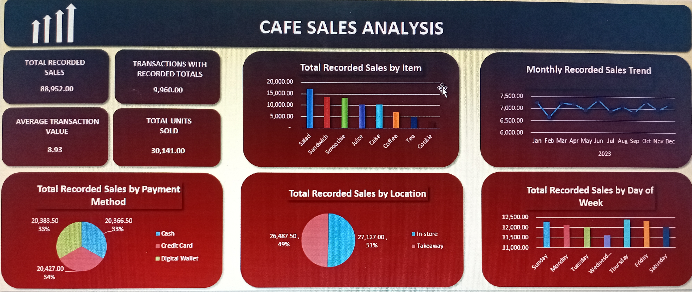

# Café Sales Analysis

## Project Overview
This project analyses café transaction data to identify sales patterns, customer purchasing behaviour, and trends across products, payment methods, locations, and days of the week.

The project demonstrates practical data analysis skills using Python, SQL, and Microsoft Excel.

## Project Objectives
- Clean and prepare raw café transaction data for analysis.
- Analyse recorded sales and quantities sold across different products.
- Examine sales by payment method and transaction location.
- Identify monthly and daily sales trends.
- Build an interactive Excel dashboard to communicate key findings.

## Tools and Technologies
- **Python:** Data cleaning and preparation.
- **SQL (SQLite):** Data querying and analysis.
- **Microsoft Excel:** PivotTables, charts, and dashboard development.
- **VS Code:** Writing and managing project scripts.
- **DB Browser for SQLite:** Running SQL queries.

## Dataset
The dataset contains 10,000 café transaction records with eight original columns, including transaction ID, item, quantity, price per unit, total spent, payment method, location, and transaction date.

**Source:** [Café Sales Dirty Dataset — Kaggle](https://www.kaggle.com/datasets/ahmedmohamed2003/cafe-sales-dirty-data-for-cleaning-training)

The original dataset is included for reference. A cleaned version was also prepared for analysis.

## Data Cleaning
The raw dataset contained missing values and inconsistent placeholder entries, including `ERROR` and `UNKNOWN`.

The cleaning process involved:
- Identifying and handling invalid placeholder values.
- Converting numeric columns to appropriate data types.
- Converting transaction dates to date format.
- Filling missing values where reasonable and possible.
- Preserving records where values could not be reliably inferred.
- Checking calculated totals for consistency.

All 10,000 records were retained. Some missing values remained where reliable replacements could not be determined.

## Analysis Performed
SQL queries were used to examine:
- Total records and data quality.
- Recorded sales and average transaction value.
- Sales and quantities by product.
- Sales by payment method and location.
- Monthly sales trends.
- Sales and transaction counts by day of the week.

Excel PivotTables and charts were used to summarise the results and build a dashboard.

## Key Findings
- **Total recorded sales:** 88,952.00.
- **Transactions with recorded sales totals:** 9,960 out of 10,000.
- **Average transaction value:** Approximately 8.93.
- **Top-selling product by recorded sales:** Salad.
- **Highest-revenue payment method:** Credit Card, based on the analysed records.
- **Location comparison:** In-store and takeaway sales were compared using the Excel dashboard.
- **Time-based analysis:** Monthly trends and differences across days of the week were explored.

*Note: Recorded sales are not profit. The dataset does not provide sufficient cost information to calculate profit.*

## Dashboard
The Excel dashboard presents key performance indicators and visualisations covering:
- Recorded sales by item.
- Recorded sales by payment method.
- Recorded sales by location.
- Monthly recorded sales trends.
- Recorded sales by day of the week.

## Project Files
The project includes the original dataset, cleaned dataset, Python cleaning script, SQL analysis queries, and Excel workbook containing the dashboard and PivotTables.

## Conclusion
This project demonstrates a practical data analysis workflow, from cleaning raw data to querying records, identifying patterns, and communicating findings through a dashboard.

It also highlights the importance of data quality and clearly distinguishing recorded sales from other financial measures such as profit.

